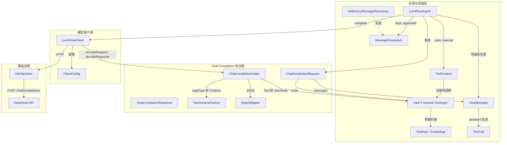

# Lumirose v1 产品与技术设计

## 1. 文档信息

| 项目 | 内容 |
|---|---|
| 文档负责人 | Lumirose 项目组 |
| 产品版本 | v1 |
| 文档状态 | 待评审 |
| 更新时间 | 2026-11-06 |
| 运行环境 | Java 17+ |
| 交付方式 | 可嵌入 Java 应用的 Maven 依赖 |
| 模型协议 | DeepSeek Chat Completions，同步调用 |

## 2. 背景与问题

Java 应用接入工具型智能体时，通常需要重复实现模型调用循环、工具定义与分发、消息历史和失败处理。当前 demo 已验证 DeepSeek Chat Completions 的同步调用和工具调用路径，但模型类型、消息类型、工具执行和仓储边界仍相互耦合，同步与流式实现也不一致。

v1 将现有 demo 收敛为最小可用框架：直接调用 DeepSeek Chat Completions，提供类型化工具、同步 Agent、内存会话仓储和基础本地工具。

## 3. 目标与成功指标

### 3.1 产品目标

- 让 Java 开发者通过 Maven 依赖嵌入一个通用单智能体。
- 用少量稳定的核心类型完成工具定义、注册、执行和会话记忆。
- 避免 openai-java 类型进入 Agent、Tool、Repository 等公共边界。
- 让同步运行、工具失败、消息提交和并发行为可预测、可测试。

### 3.2 发布门槛

| 指标 | 门槛 |
|---|---|
| 核心功能 | 无工具对话、多轮工具调用、基础文件工具和 PowerShell 工具均通过验收 |
| 自动化验证 | 默认测试不读取真实 API Key，使用 MockWebServer |
| 接入体验 | 按文档配置 Client、Agent、ToolContext 后能运行同步示例 |
| 行为一致性 | 成功、失败、轮数上限和同会话并发遵循统一规则 |
| 安全 | 源码和文档不含真实凭据；日志和异常不泄露敏感内容 |

v1 不默认发送遥测。

## 4. 用户与场景

目标用户是需要将 AI 对话或工具能力嵌入 Java 应用的开发者。

主要场景：

1. **应用内问答**：按 conversationId 保存并延续上下文。
2. **工具调用**：模型选择工具后，框架解析参数、执行工具并继续对话。
3. **本地文件操作**：在受限工作区内读取、创建、编辑和删除文本文件。
4. **命令执行**：应用显式启用 PowerShell 工具后，执行非交互命令。
5. **自定义持久化**：简单应用使用内存仓储，生产应用实现仓储接口。

## 5. 范围与优先级

### P0

- Java 17+ Maven 依赖；
- DeepSeek Chat Completions 同步调用；
- 单 Agent；
- 类型化 Tool 和 ToolContext；
- ChatMessage 消息模型；
- 会话历史与原子提交；
- 线程安全内存仓储；
- ReadTool、WriteTool、EditTool、DeleteTool；
- PowerShellTool；
- 不依赖真实 API 的自动化测试。

### 非目标

- 流式调用和 Reactor；
- Responses API、Anthropic Messages API；
- openai-java；
- MySQL、ORM 或建表 SQL；
- 多智能体、工作流、RAG；
- 自动上下文裁剪；
- 工具并行执行或人工审批；
- 独立 HTTP 服务或遥测。

## 6. 功能需求

| ID | 需求 | 可观察行为 |
|---|---|---|
| FR-01 | Client 配置 | baseUrl 和 apiKey 必填；v1 不提供 fromEnv、自定义 OkHttpClient 或 ObjectMapper 注入 |
| FR-02 | 同步运行 | `LumiRoseAgent.run(conversationId, input)` 返回最终文本；模型错误抛出框架异常 |
| FR-03 | 工具定义 | 工具实现 `Tool<T extends ToolArgs>`；简单工具可用 `Tool.of`，无参数工具使用 EmptyArgs |
| FR-04 | 工具注册与执行 | ToolContext 拒绝重复名称和 null；按名称查找、解析参数并执行；失败立即终止运行 |
| FR-05 | 多工具调用 | 同一轮的多个 ToolCall 按模型返回顺序串行执行；每个结果对应一条 ToolMessage |
| FR-06 | 会话历史 | 按 conversationId 加载历史；空会话首次加入 system 消息；支持内存和自定义仓储 |
| FR-07 | 消息提交 | 本轮消息暂存，最终成功才原子追加；任何失败或轮数超限均不提交本轮消息 |
| FR-08 | 并发 | 同一 Agent 实例内同一会话串行，不同会话并行；Client 支持多会话并发 |
| FR-09 | 轮数限制 | maxTurns 默认 10；初始请求和工具后的请求都计入 |
| FR-10 | 文件工具 | 四个文件工具限制在工作区内，只处理 UTF-8 普通文件，失败不破坏原文件 |
| FR-11 | PowerShell 工具 | 默认不注册；显式配置后非交互执行，限制超时、输出和环境变量 |
| FR-12 | 错误与安全 | 统一框架异常；不记录 API Key、完整请求、工具参数或工具结果 |

## 7. 总体架构



依赖约束：

- Agent 只编排模型、工具和会话，不包含 HTTP 细节。
- ToolContext 只管理工具和执行，不依赖 DeepSeek Wire 结构。
- Tool 不依赖 OkHttp、DeepSeek DTO 或 Agent。
- LumiRoseClient 只处理单次同步模型调用。
- v1 不建立公共 Wire DTO 层。

## 8. 公共使用方式

```java
LumiRoseClient client = LumiRoseClient.builder()
        .baseUrl("https://api.deepseek.com")
        .apiKey(System.getenv("DEEPSEEK_API_KEY"))
        .build();

ToolContext tools = ToolContext.builder()
        .register(readTool)
        .registerAll(toolList)
        .build();

LumiRoseAgent agent = LumiRoseAgent.builder()
        .client(client)
        .model("deepseek-flash")
        .systemMessage("你是一个简洁的智能体")
        .toolContext(tools)
        .repository(new InMemoryMessageRepository())
        .maxTurns(10)
        .build();

String answer = agent.run(conversationId, "读取 README.md");
```

Client 和 ToolContext 应在应用生命周期内复用。

## 9. 工具模型

```java
public interface Tool<T extends ToolArgs> {
    String name();
    String description();
    Class<T> argsType();
    Object execute(T args);
}
```

- `ToolArgs` 是标记接口。
- `EmptyArgs` 表示无业务参数。
- `Tool.of(name, description, argsType, handler)` 创建轻量工具。
- 复杂工具通过类实现并注入依赖。
- `execute` 不声明受检异常；工具内部转换为框架异常。
- 工具名称由 Tool 显式提供，不从参数类名推导。
- v1 不开启 DeepSeek strict 工具模式。

天气和时间的 demo 工具从生产代码删除。测试需要时使用 `src/test` 下的测试工具。

## 10. ToolContext

```java
ToolContext context = ToolContext.builder()
        .register(tool)
        .registerAll(tools)
        .build();
```

契约：

```java
List<Tool<?>> tools();

String execute(String toolName, String argumentsJson);
```

职责：

- 保存不可变工具快照；
- 拒绝 null 和重复名称；
- 按名称查找 Tool；
- 使用 `argsType()` 解析参数；
- 调用 `execute(T)`；
- 将工具结果序列化为 JSON 字符串；
- 转换查找、解析和执行异常。

`tools()` 只由 Agent 调用。Client 不直接依赖 ToolContext。

## 11. 消息模型

```java
public sealed interface ChatMessage permits
        SystemMessage,
        UserMessage,
        AssistantMessage,
        ToolMessage {
}
```

```java
public record SystemMessage(String content) implements ChatMessage {}
public record UserMessage(String content) implements ChatMessage {}
public record AssistantMessage(
        String content,
        String reasoningContent,
        List<ToolCall> toolCalls
) implements ChatMessage {}
public record ToolMessage(
        String toolCallId,
        String content
) implements ChatMessage {}
```

```java
public record ToolCall(
        String id,
        String type,
        Function function
) {
    public record Function(String name, String arguments) {}
}
```

规则：

- `role` 作为 Jackson 多态判别字段；
- 四种消息直接使用 ObjectMapper 序列化；
- assistant 可为 content null，并保留 reasoningContent 和多个 toolCalls；
- tool 消息只对应一个 toolCallId；
- `arguments` 保持模型返回的 JSON 字符串；
- 不创建公共 WireMessage 或 WireToolCall。

多个工具调用对应多条 tool 消息：

```text
AssistantMessage(toolCalls=[c1, c2])
ToolMessage(toolCallId=c1, content=result1)
ToolMessage(toolCallId=c2, content=result2)
```

## 12. ChatCompletionCodec

v1 使用一个内部 Codec，不拆分多个公共 Encoder/Decoder。

```java
final class ChatCompletionCodec {
    ObjectNode encodeRequest(ChatCompletionRequest request);
    ChatCompletionResponse decodeResponse(String responseBody);
    private JsonNode encodeTool(Tool<?> tool);
    private JsonNode createToolSchema(Class<?> argsType);
}
```

职责：

- 序列化 ChatMessage 和 ToolCall；
- 将 Tool 转为 DeepSeek tools JsonNode；
- 根据 `argsType()` 生成 parameters schema；
- 组装请求；
- 解析并校验响应；
- 使用一个 ObjectMapper 作为 JSON 引擎。

`encodeTool` 生成完整 `{type, function}`；`createToolSchema` 只生成 parameters。v1 不引入公共 Wire DTO。

## 13. LumiRoseClient

```java
public final class LumiRoseClient {
    private final ClientConfig config;
    private final OkHttpClient httpClient;
    private final ChatCompletionCodec codec;

    public ChatCompletionResponse complete(ChatCompletionRequest request);
}
```

职责：

- 校验请求；
- 编码请求；
- 通过 OkHttp 同步执行；
- 处理超时和重试；
- 关闭每次 Response body；
- 解析响应；
- 映射 HTTP/API 错误。

Client 不负责会话、工具执行、Agent 轮次或持久化。

生命周期：

- 应用级长期对象，应复用；
- 支持多会话并发；
- 不实现 AutoCloseable、close 或 closed；
- OkHttp 自动淘汰空闲连接；
- 每次 Response 仍必须通过 try-with-resources 关闭。

### ClientConfig

| 配置 | 默认值 |
|---|---:|
| baseUrl | 必填 |
| apiKey | 必填 |
| connectTimeout | 10 秒 |
| writeTimeout | 30 秒 |
| readTimeout | 120 秒 |
| callTimeout | 180 秒 |
| maxRetries | 2 |

- ClientConfig 只保存 baseUrl，不保留重复的 endpoint；
- 请求时派生 `/chat/completions`；
- v1 不提供 fromEnv；
- v1 不接受自定义 OkHttpClient 或 ObjectMapper；
- OkHttp 原生连接重试关闭。

### HTTP 与重试

```http
POST {baseUrl}/chat/completions
Authorization: Bearer {apiKey}
Content-Type: application/json
Accept: application/json
```

自动重试 429、500、503；不重试 400、401、402、422。优先使用 Retry-After，否则进行带抖动的指数退避。

错误映射由 Client 内部完成，不为 v1 增加公共 Retry SPI 或 ErrorMapper SPI。

## 14. Agent 行为

1. 获取同一 conversationId 的执行权。
2. 加载历史快照。
3. 新会话加入 system 消息。
4. 加入 user 消息。
5. 获取 ToolContext 工具快照。
6. 构造 ChatCompletionRequest。
7. 调用 Client 并保存 assistant 消息。
8. finishReason 为 tool_calls 时，按顺序执行工具并加入 tool 消息。
9. 继续调用，直到得到最终文本或达到 maxTurns。
10. 成功后一次性提交本轮消息并返回最终 content。

失败规则：

- 模型请求、参数解析、工具执行或仓储失败时抛出框架异常；
- 失败运行不提交本轮消息；
- 达到 maxTurns 视为失败；
- 工具失败不自动反馈给模型，也不自动重试；
- 已执行工具的外部副作用不会回滚；
- v1 不自动裁剪或摘要历史。

reasoningContent 在携带工具的请求中必须保存并回传，否则 DeepSeek 可能拒绝后续请求。

## 15. 会话仓储

```java
List<ChatMessage> load(Long conversationId);

void appendAll(Long conversationId, List<ChatMessage> messages);
```

- load 返回不可修改快照；
- appendAll 必须原子；
- InMemoryMessageRepository 线程安全；
- 存储框架 ChatMessage，不存储 Wire JSON；
- 成功运行仅提交一次；
- 生产持久化由调用方实现接口。

## 16. 未来持久化逻辑模型

v1 不实现 MySQL，也不提供 SQL。

| 字段 | 说明 |
|---|---|
| messageId | UUID，每条消息唯一 |
| conversationId | 所属会话 |
| sequenceNo | 会话内顺序 |
| role | system、user、assistant、tool |
| content | 消息正文，assistant 可为 null |
| reasoningContent | DeepSeek 思考内容 |
| toolCalls | assistant 的多个 ToolCall |
| toolCallId | tool 消息对应的单个调用 ID |
| createdAt | Instant，UTC 绝对时间 |

不额外增加自增 id。assistant 的 toolCalls 保存列表；tool 消息的 toolCallId 是单个字符串。MessageDO 只作为未来持久化适配模型。

## 17. 内置工具

### 文件工具

- ReadTool：按行窗口读取文本并报告截断；
- WriteTool：创建或显式覆盖文件；
- EditTool：精确文本替换，默认要求唯一匹配；
- DeleteTool：只删除普通文件，不递归目录。

共同规则：

- 工作区根目录必填；
- 拒绝绝对路径、越界路径和越界符号链接；
- 只处理 UTF-8 普通文件；
- 写入和编辑使用原子替换；
- 不暴露工作区绝对路径。

### PowerShellTool

- 默认不注册；
- 必须显式配置工作区和可执行文件；
- 非交互执行；
- 限制超时、输出大小和环境变量；
- 非 0 退出码作为结果返回，启动失败、超时或越界作为工具异常；
- 工作目录不是安全沙箱；
- 注册即授权系统命令执行能力。

## 18. 非功能要求

| 类别 | 要求 |
|---|---|
| 平台 | Java 17+，Maven |
| 并发 | Client 可并发；Agent 同会话串行；Tool 实现需线程安全或不含共享可变状态 |
| 兼容 | v1 只承诺 DeepSeek Chat Completions 同步协议 |
| 安全 | API Key 显式注入；日志和异常脱敏；文件工具限制工作区 |
| 可测试 | MockWebServer 覆盖协议，不要求真实模型 |
| 资源 | 复用 Client；每次 Response 必须关闭 |
| 隐私 | 不默认发送遥测，不记录工具参数和结果 |

## 19. 验收标准

1. 无工具同步对话返回最终文本。
2. 模型工具调用可被执行，结果以正确 toolCallId 返回。
3. 多个 ToolCall 产生多条 ToolMessage，并按顺序执行。
4. 工具参数解析使用 argsType，未知工具和参数错误终止运行。
5. 成功运行原子提交消息，失败和达到 maxTurns 不提交。
6. 同一会话并发按顺序处理，不同会话可并行。
7. Client 正确生成请求 URL、认证头和 JSON。
8. 429、500、503 按策略重试，400、401、402、422 不重试。
9. 所有 Response body 在成功、失败和重试时均关闭。
10. reasoningContent 可保存并随工具历史回传。
11. 文件工具拒绝工作区外路径，失败写操作不破坏原文件。
12. PowerShell 工具未显式注册时不可调用，超时和环境隔离符合配置。
13. 默认测试不读取真实 API Key。
14. 源码、测试和文档不含真实凭据。

## 20. 风险与依赖

- DeepSeek API 字段或错误语义可能变化，需保持响应兼容测试。
- 思考模式下 reasoningContent 缺失可能导致工具历史请求失败。
- PowerShellTool 可访问工作区外文件和网络，不是安全沙箱。
- 自动执行工具可能产生无法回滚的外部副作用。
- v1 不管理上下文长度，调用方需控制会话规模。
- 内存仓储不持久，进程重启后历史丢失。
- 当前测试源码曾包含硬编码凭据，发布前必须撤销、轮换并清理。
- Client 必须长期复用；高频创建会增加连接池和延迟成本。

## 21. 发布与 v2

发布前：

1. 完成 P0 自动化验收；
2. 删除生产中的 WeatherTool 和 TimeTool；
3. 清理真实凭据；
4. 验证 Java 17 和 Maven 构建；
5. 确定 artifact 坐标和发布仓库。

v2 候选：

- OkHttp SSE 流式响应；
- 文本与 reasoning delta；
- 流式 tool_calls 参数合并；
- 取消与事件模型；
- Responses 或 Messages 协议适配。

v1 不保留空 stream 方法，也不引入 Reactor。

## 22. 参考

- [DeepSeek Chat Completions API](https://api-docs.deepseek.com/zh-cn/api/create-chat-completion)
- [DeepSeek Tool Calls](https://api-docs.deepseek.com/zh-cn/guides/tool_calls)
- [DeepSeek 思考模式](https://api-docs.deepseek.com/zh-cn/guides/thinking_mode)
- [DeepSeek 错误码](https://api-docs.deepseek.com/zh-cn/quick_start/error_codes)
- [openai-java](https://github.com/openai/openai-java)
- [OkHttp](https://github.com/lysine-dev/okhttp)
